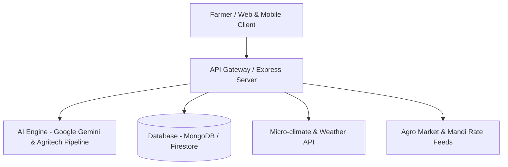

<div align="center">


# AgriGPT OS

### *The Operating System & AI Copilot for Smart, Resilient & Sustainable Farming*

[](LICENSE)
[](https://github.com/solutiondevelopers/AgriGPT_OS)
[](https://react.dev/)
[](https://nodejs.org/)
[](https://ai.google.dev/)
[](#)

---

<p align="center">
  <strong>AgriGPT OS</strong> is an open next-generation agricultural operating platform designed to bridge the gap between artificial intelligence and grassroots farming. It equips farmers, agronomists, and agri-enterprises with real-time decision-making capabilities, diagnostic intelligence, predictive analytics, and vernacular conversational support.
</p>

</div>

---

## 🌟 Key Features

### 🌾 AI Crop Advisory & Plant Health Diagnosis
- **Multimodal Disease Detection:** Upload or capture crop leaf images for rapid disease identification and treatment plans.
- **Context-Aware Recommendations:** Tailored advice based on local weather conditions, crop growth stages, and soil characteristics.
- **Bilingual & Vernacular Support:** Conversational assistance across regional Indian languages to empower farmers in their native tongue.

### 📊 Real-Time Analytics & Soil Intelligence
- **Soil Metric Tracking:** Monitor NPK levels, pH balance, moisture content, and organic carbon health.
- **Predictive Yield Modeling:** Data-driven harvest forecasting based on historical trends and climatic parameters.
- **Resource Optimization:** Smart irrigation scheduling and fertilizer dosage calculator to reduce waste and boost yield.

### 🌤️ Weather & Micro-Climate Forecasts
- Precision hyper-local weather alerts, monsoon predictions, frost cautions, and storm warnings.
- Actionable advisories tied directly to anticipated rainfall and humidity shifts.

### 🛒 Agro-Store & Supply Chain Integration
- Connect with verified seed suppliers, organic fertilizers, and modern equipment vendors.
- Transparent market pricing and mandi rate tracking.

### 🗺️ 3D Farmland & Spatial Visualization
- Interactive terrain exploration and spatial farm mapping powered by 3D rendering (`Three.js`).

---

## 🏗️ Architecture & Technology Stack



| Layer | Technology |
|---|---|
| **Frontend** | React 19, TypeScript, Tailwind CSS, Vite, Lucide Icons, Framer Motion |
| **Backend** | Node.js, Express, TypeScript / tsx |
| **Artificial Intelligence** | Google Gemini API (`@google/genai`), Agronomic Prompt Engineering |
| **Data Visualization** | Recharts, Three.js (3D Terrain & Mapping) |
| **Database** | MongoDB / Firestore |

---

## 🚀 Getting Started

### Prerequisites

Ensure you have the following installed on your machine:
- [Node.js](https://nodejs.org/) (version 18.0.0 or higher)
- [npm](https://www.npmjs.com/) or [bun](https://bun.sh/)
- [Git](https://git-scm.com/)

### 1. Clone the Repository

```bash
git clone https://github.com/solutiondevelopers/AgriGPT_OS.git
cd AgriGPT_OS
```

### 2. Install Dependencies

```bash
npm install
```

### 3. Configure Environment Variables

Create a `.env` file in the root directory:

```bash
cp .env.example .env
```

Add your required configuration keys:

```env
PORT=3000
GEMINI_API_KEY=your_google_gemini_api_key_here
MONGODB_URI=your_mongodb_connection_string_here
```

### 4. Run Development Server

```bash
npm run dev
```

Visit `http://localhost:3000` to interact with AgriGPT OS.

---

## 📁 Repository Structure

```text
AgriGPT_OS/
├── logo/
│   ├── agriGPT.png            # AgriGPT primary brand logo
│   └── agriGPT.png.png        # Source asset
├── README.md                  # Project overview and documentation
```

---

## 🗺️ Roadmap

- [x] Brand identity & core system architecture design
- [ ] Direct IoT soil sensor integration via MQTT/LoRaWAN
- [ ] Offline-first Progressive Web App (PWA) with SMS fallback
- [ ] Voice-first conversational interaction for rural accessibility
- [ ] Community knowledge-sharing hub for farmers

---

## 👥 Contributors & Author

- **Hariom Sandve** - *Lead Developer & Architect* - [@hariomsandve](https://github.com/hariomsandve)
- **Solution Developers** - *Organization* - [@solutiondevelopers](https://github.com/solutiondevelopers)

---

## 📄 License

This project is licensed under the MIT License - see the [LICENSE](LICENSE) file for details.

<div align="center">
  <sub>Built with ❤️ for farmers worldwide by <strong>Solution Developers</strong></sub>
</div>
